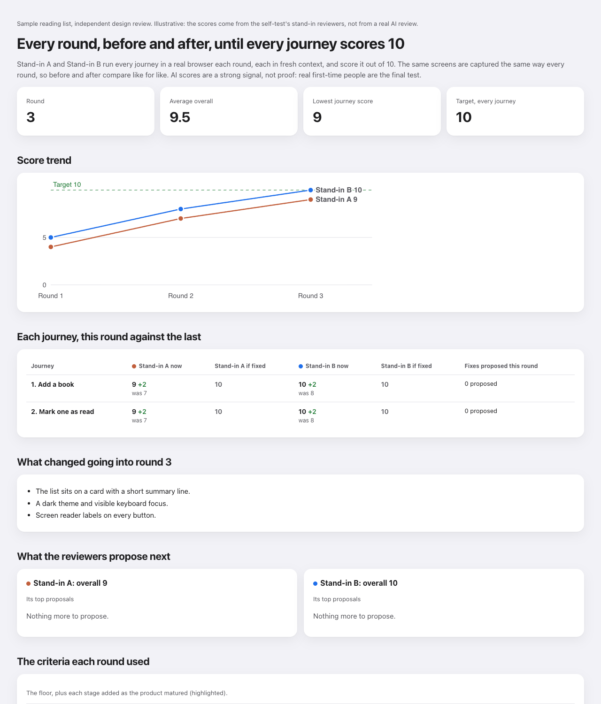

# mStack

**Agent skills that take you out of every job you do not need to be in. I use them every day. Any agent, free, MIT.**

[](https://github.com/mark-hallam/mstack/releases)
[](LICENSE)
[](#install-in-30-seconds)
[](#check-it-works)

## The four jobs you do not need to be in

1. **Sitting there in case the agent needs you.** It asks a question at minute 40, and you were in a meeting.
2. **Answering the same questions one at a time.** Ten rounds of "and which folder?" before any work starts.
3. **Babysitting background work.** You want things to keep moving overnight, inside what you already pay for, without a surprise bill or a push you did not approve.
4. **Guessing whether it is ready.** One opinion, usually the agent's own, on whether the thing you built is good enough to show people.

mStack is five skills, one for each of those and one for being away from your desk, written for humans
and agents alike. **You never have to call a skill by name.** Install mStack and every skill switches on
by itself when its moment comes. Switch any of them off whenever you like.

**Proof it switches on by itself:** on 7 November 2026, on a clean Claude Code profile with none of my
own rules or memory, six plain phrases a stranger might type each picked the right skill, six out of six.
Cursor did the same with Grok from a single rules block. Details and dates in [docs/evidence.md](docs/evidence.md).

## Install in 30 seconds

**Claude Code**, as a plugin (updates itself):

```
/plugin marketplace add mark-hallam/mstack
/plugin install mstack@mstack
```

**Codex**: clone this repository, then ask Codex to run
`python3 skills/mstack/scripts/mstack.py setup codex`. It shows what it would add to `~/.codex/AGENTS.md`
(so the skills switch on by themselves) and `~/.codex/config.toml` (ping-me; a `notify` program you already
have is chained, not replaced), and writes it only after you say yes.

**Cursor**: `python3 skills/mstack/scripts/mstack.py setup cursor --project <your project>` adds an
always-applied rule, after showing it to you.

**Any other agent** (ChatGPT, Gemini, and others that can run commands): give it this link and say what you
want: https://github.com/mark-hallam/mstack/blob/main/docs/agents.md

Nothing else to install: Python 3.9 or later, standard library only. Node.js 18 or later and Google
Chrome or Chromium are needed only by the review loop and by phone-width screenshots.

## The skills

| Skill | What it does | Default |
|---|---|---|
| [ping-me](skills/ping-me/SKILL.md) | Tells you on your phone and watch, without being asked, whenever your agent needs your decision or input, or a task you asked for is done or blocked. So you can walk away. | On |
| [outcome-first](skills/outcome-first/SKILL.md) | Your agent pins down the outcome you want, asks every question once (with sensible defaults), then works to a verified result on its own, in parallel, surviving restarts and usage limits, and reports once. | On |
| [crew](skills/crew/SKILL.md) | Keeps useful work running in the background all the time, within the usage you already pay for: one queue across your projects, the cheapest model that fits each job, your 15% of every usage window kept, drafts and side branches only, one morning digest with evidence. | On |
| [multi-evaluator](skills/multi-evaluator/SKILL.md) | Improves a product's design in rounds until it is ready for real people: every user journey 9 or better from independent AI reviewers made by different companies, agreeing within a point, with no high-severity fix open, two rounds running. Before and after screenshots and a report every round. | On |
| [away-mode](skills/away-mode/SKILL.md) | Notices by itself when you are away from your computer and following from your phone, and presents every output in a form the phone can show: screenshots, PDFs, files sent to the chat, and the key points in the message. | On |
| [mstack](skills/mstack/SKILL.md) | The index: which skills switch on when, the on and off switches, and private self-improvement ("review my skills"). | Always |

### ping-me: walk away, get pinged

Whenever your agent needs you (a decision, an approval, something only you can do) or finishes or gets
stuck on something you asked for, it notifies you straight away, in one short line that leads with what
you need to do. What honestly reaches your phone: in Claude Code, with Remote Control connected, the
Claude app delivers it to your phone and watch; in Codex, Cursor and headless runs the ping is a desktop
alert on the computer, which does not reach a phone, unless you opt in to ntfy, a free phone push app
(`mstack.py setup ntfy` walks you through it and writes nothing until you say yes; it is off by default
because it sends the text to a third party). "No pings" for one task is forgotten next session by design;
the off switch in `~/.mstack/config.json` is remembered.

### outcome-first: ask once, then done

For any real piece of work, your agent first works out everything it will need and asks it all in one go,
with defaults so you can just say "go". Then it plans the work so independent parts run in parallel, keeps
a progress file that survives restarts, schedules its own resume if a usage limit stops it, and only stops
when the outcome is proven with evidence (tests passing, a page loading, a file you can open), not on its
own say-so. You hear from it again when it is done, or when a decision is genuinely yours.

### crew: everything, all the time, within what you already pay for

Each project says where its work comes from, in a small private config outside the repository: a plan or
backlog file, an evaluator's "do these next" list, failing tests, a daily job. Crew turns those into one
queue with an outcome, done checks, a model tier and an estimate for each job, and runs them on the
cheapest model that can do them, with only the files each job needs, heavy jobs in the hours you are not
using your own sessions. Usage is measured, never guessed: Claude Code's own rate limit event and Codex's
session log say how full each window is, and crew uses a runner only up to 85% of it; at your last 15% it
stops and asks. Everything is drafts and side branches: nothing is sent, posted, merged, deployed, deleted
or paid for; each of those becomes a question with a default. A job that fails is tried again, up to three
times, with the last failure in its next brief, then parked for you with the check's output kept. Shared
things such as the browser are locked, so two jobs never fight over them. One digest a day: what finished
with commit SHAs and test results, what waits for you, and usage against the cap, with a ping.

### multi-evaluator: keep improving until it is ready for people

You describe what a real person must be able to do with your app, site or document (the journeys) and
what good looks like (the criteria: clear, quick, trust, familiar, calm, works everywhere, and more as it
matures). Each round, the same screens are captured the same way; at least two reviewers from different
AI makers (Claude and Codex by default; Grok through Cursor works too) each drive the real product in a
real browser, in fresh context, and score every journey 0 to 10 with an "if fixed" score and specific
fixes. Every verdict records which maker and model ran. A frozen control set is scored every round, so a
move smaller than a reviewer's own noise is never reported as progress. You get one HTML page with the
score trend, each journey against last round, the proposals, before and after screenshots, and a filmstrip
of every round. The loop stops at ready for people: every journey 9 or better from every reviewer,
reviewers within a point of each other, no high-severity fix open, held for two rounds. A unanimous 10 is a
flag to double check, not the goal. AI scores are a strong signal, not proof.



The example above is [examples/sample-report.html](examples/sample-report.html)
([view it in your browser](https://htmlpreview.github.io/?https://github.com/mark-hallam/mstack/blob/main/examples/sample-report.html)),
made by the self-test from a tiny sample page. Its scores come from stand-in reviewers, so they are
illustrative only.

### away-mode: following from your phone, without asking for screenshots

You start a job at your desk and follow it from your phone. From there you cannot click a local path, run
an `open` command or look at a file on the computer. Before presenting anything, your agent checks whether
you are away: your own words win ("I'm on my phone", "I'm back"), then what the harness tells it, then the
machine itself (keyboard and mouse idle for 10 minutes, a locked screen, a sleeping display). When you are
away, or it cannot tell, it makes phone-readable copies (an HTML report becomes a PDF and a phone-width
light-theme screenshot; a local web app becomes desktop and phone screenshots), sends them into the chat,
and puts the 3 to 5 key points in the message itself. Never just a path.

## Numbers

Only measured ones, each with its date and source in [docs/evidence.md](docs/evidence.md):

- **6 of 6** plain phrases routed to the right skill on a clean install (7 November 2026).
- **3 of 3** AI makers (Anthropic, OpenAI, xAI), reviewing blind in a real browser, found the same bug in
  one review round of a real app. Their overall scores still differed by up to 2.7 points, which is why the
  loop needs them to agree before it says ready.
- **0 points** of noise from one reviewer across five rounds on frozen screens; **2 points** from another.
  The report marks any change smaller than a reviewer's own noise as within noise.
- **1 of 1** crew jobs refused a runner's "done" because the crew's own check failed, and said why.

No speed, cost or quality figures yet: none have been measured properly. No user counts: there are none.

## How it compares

The popular skill stacks make your agent a better engineer. mStack takes you out of the jobs you do not
need to be in, and works alongside them. See [docs/comparison.md](docs/comparison.md).

## Switching skills off

- Everywhere: `python3 skills/mstack/scripts/mstack.py disable ping-me` (or `enable`), or edit
  `~/.mstack/config.json` yourself: `{"disabled": ["ping-me"]}`.
- For one task: just tell your agent, for example "don't use outcome-first for this" or "no pings".

## Skills that get better, privately

After each use, your agent records one line about how it went (the outcome, where it needed you, where it
stalled, what you corrected) in `~/.mstack/journal/` on your own computer. Every so often, or when you say
"review my skills", it gathers that into evidence and proposes specific improvements. You accept the ones
you want, and they are kept in `~/.mstack/learned/`, surviving updates. Nothing leaves your computer unless
you choose to share an improvement (for example as an issue or pull request here).

## For agents

A plain page any agent can read and follow from a bare link: [docs/agents.md](docs/agents.md).
Everything the skills do is also a command with `--json` output, so an agent gets the same answers a
person does.

## Check it works

```
python3 tests/run_all.py
```

This runs the leak and style scan, the packaging checks, and each skill's self-test: switches, pings (to a
stand-in, never your real desktop), the private journal and reviews, the setup for each agent (on temporary
copies of the settings files), the outcome plan with a stand-in crontab, away detection with stand-in
machine signals plus a real render when Chrome is present, the crew queue with a stand-in runner on a
throwaway repository (the stop and ask at the reserve, retries, the browser lock, the stop file, an install
dry run that writes nothing), and three review rounds on a tiny local page with stand-in reviewers (no AI
and no network beyond your own computer).

## Licence

MIT. Copyright (c) 2026 Mark Hallam. See [LICENSE](LICENSE).
